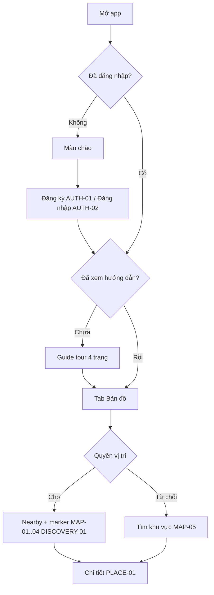
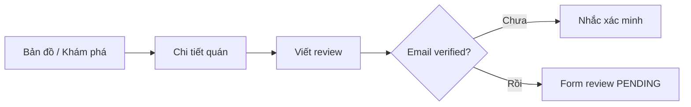
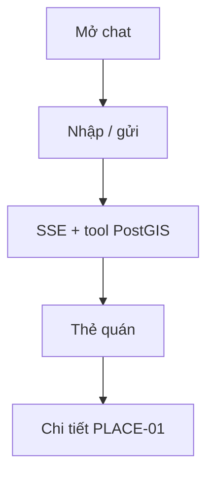
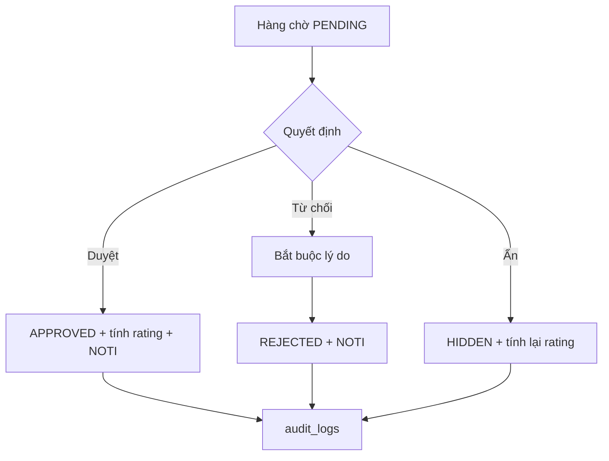

# Luồng người dùng v1

## Lần mở app

**Bắt buộc đăng nhập** — app không có chế độ khách (quyết định 2026-10-27). Chưa đăng nhập,
hoặc phiên hết hạn (401 sau khi refresh thất bại), hay đăng xuất → về màn chào.

Quyền vị trí chỉ xin **sau** guide tour, lúc vào tab Bản đồ. Cờ "đã xem hướng dẫn" lưu theo
thiết bị: đăng ký tài khoản thứ hai trên cùng máy không xem lại tour.

## Từ bản đồ tới đánh giá

Đã có review: form chế độ cập nhật (REVIEW-04). Upload lỗi: thử lại **từng file**.

## Chatbot

## Kiểm duyệt

